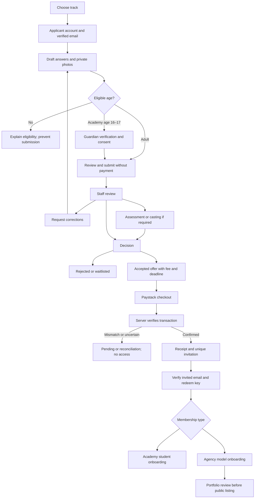
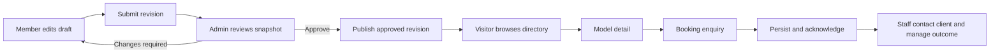
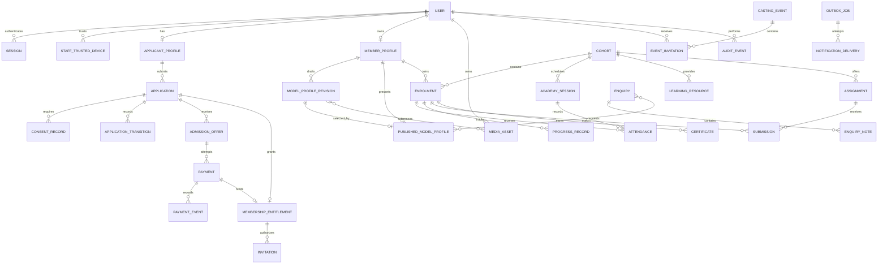

# Psycocity — Product and Technical Specification

Version: 2.1

Status: implementation baseline

Updated: 28 October 2026

## 1. Product purpose

Psycocity is a Nigerian modelling agency and hybrid training academy. Its digital platform combines a premium public website, application and assessment portal, invitation-only member platform, public model catalogue, and staff administration.

The experience should communicate premium fashion through photography, editorial typography, generous space, and restrained colour. Public pages should be simple; operational portals should make applications, training, representation, and bookings easy to manage.

## 2. Confirmed product decisions

- Use React 19, TypeScript, Tailwind CSS, TanStack Query, React Router v7 through `react-router`, Node.js, Express, and MongoDB.
- Primary brand colour: `#e7db9d`.
- Operate in Nigeria, with Paystack payments in Nigerian naira only.
- Academy applicants must be at least 16. Established-model applicants and represented agency models must be at least 18.
- Academy fee: ₦50,000, covering tuition and assessment/application charges as one fee.
- Established-model fee: ₦30,000, covering the application/assessment and onboarding charge as one fee. Established models do not enter academy tuition automatically.
- Applications are submitted and assessed before payment. Payment is requested only after acceptance.
- Verified payment unlocks a unique invitation key for member registration.
- Applicant access and member access are separate experiences and permissions.
- Academy delivery is hybrid: online and in-person.
- Approved agency models have public listing and detail pages.
- Admins approve public profile changes and photographs.
- Multiple administrators share agency operational permissions and individual accounts. Only the original seeded super admin may invite or remove administrator access.
- Notifications use email initially.
- The public site includes booking enquiries.

Amounts above are the total advertised charges. Do not add an undisclosed application fee or pass payment-processing charges to applicants without a later approved product change.

## 3. Scope and delivery principles

Build admissions, payments, administration, and model representation first. Add academy operations on that foundation. Every phase includes relevant testing, mobile support, accessibility, and error handling.

Do not introduce client accounts, automated model bookings, client payments, model payouts, payroll, commissions, WhatsApp/SMS, live-video infrastructure, or a marketplace in the initial release. Booking enquiries are managed by staff; commercial agreements happen outside the platform initially.

## 4. Users and permissions

| User | Access |
| --- | --- |
| Visitor | Public pages, published model profiles, booking/contact forms, application entry |
| Applicant | Own application, draft uploads, assessment invitations, decisions, accepted-offer payment, receipts |
| Academy student | Own private member profile, cohort, lessons, resources, attendance, assignments and progress as released |
| Agency model | Own private details, portfolio drafts, published profile preview, casting invitations |
| Administrator | Application decisions, payments, content, academy, models, enquiries and audit records; cannot invite or remove staff |
| Original super admin | All administrator operations plus staff invitations, revocation and removal of other administrators |

An individual may have applicant and member permissions. Keep application records separate from member profiles. A shared identity service may link them after verified invitation redemption; applicant credentials alone never grant member access. Member registration must explicitly consume a valid invitation. Avoid duplicate identities when the invited email already belongs to an applicant.

All authorization is enforced by the API, including record ownership and media access. Hiding a UI control is insufficient. No user can assign their own role, admission state, payment state, or publication state.

## 5. Brand and design system

### 5.1 Visual identity

- Wordmark: typography-led `PSYCOCITY`; final custom logo can follow.
- Primary: soft gold `#e7db9d`.
- Supporting palette: warm ivory `#f7f5ef`, charcoal `#191919`, muted stone `#d8d3c8`, white `#ffffff`.
- Use dark text on soft gold. Validate all final text/background combinations for contrast.
- Pair an editorial serif heading font with a legible sans serif body font. Use licensed, self-hosted assets with fallbacks.
- Draw inspiration from Zara and Dior's restraint and visual hierarchy without copying their identity or layouts.
- Use licensed placeholder images until Psycocity supplies approved photography. Do not imply placeholder subjects are represented models.

### 5.2 Interaction and layout

- Mobile-first layouts with consistent spacing, readable line lengths, and clear type hierarchy.
- Large imagery on public pages; compact, accessible forms and tables in portals.
- Responsive galleries with consistent crops and image focal points.
- Visible keyboard focus, semantic headings, labelled inputs, accessible validation, and reduced-motion support.
- Target WCAG 2.2 AA. Avoid animation that obstructs navigation or delays form completion.
- Every data-driven screen has loading, empty, success, permission-denied, and recoverable error states.
- Display money as naira and dates clearly. Store timestamps in UTC; show operational schedules in `Africa/Lagos` with an explicit timezone label.

## 6. Information architecture

### 6.1 Public routes

| Route | Purpose |
| --- | --- |
| `/` | Compact editorial landing page |
| `/models` | Approved public model directory |
| `/models/:slug` | Published model detail and enquiry CTA |
| `/join` | Academy and established-model comparison, eligibility, process, prices |
| `/academy` | Hybrid training description and application CTA |
| `/booking` | Booking enquiry form, optionally prefilled with a model |
| `/contact` | General contact and business information |
| `/faq` | Admissions, fees, photos, academy and booking questions |
| `/privacy`, `/terms`, `/refund-policy` | Published policies |

Homepage sections: hero with model-discovery CTA; brief agency introduction; two joining tracks; compact contact/footer. Secondary navigation exposes deeper information without making the homepage long.

Model directory supports pagination and a small initial set of approved professional filters, such as category and height range. Only published, active agency models appear. Do not expose private or unapproved data through search, metadata, or API responses.

Model detail shows professional name, biography, approved images and statistics, relevant experience, and an agency booking CTA. Exclude birth date, exact address, personal email/phone, guardian information, and private notes.

### 6.2 Applicant routes

`/apply`, `/applicant/register`, `/applicant/login`, `/applicant/dashboard`, `/applicant/application`, `/applicant/castings`, `/applicant/payments`.

### 6.3 Member routes

`/member/activate`, `/member/login`, `/member/dashboard`, `/member/profile`, `/member/portfolio`, `/member/castings`, `/member/security`.

Academy routes: `/member/academy`, `/member/academy/schedule`, `/member/academy/resources`, `/member/academy/progress`; assignments and assessments are introduced in the later academy phase.

### 6.4 Admin routes

`/admin/login`, `/admin/dashboard`, `/admin/applications`, `/admin/applications/:id`, `/admin/payments`, `/admin/invitations`, `/admin/models`, `/admin/profile-reviews`, `/admin/castings`, `/admin/academy`, `/admin/enquiries`, `/admin/content`, `/admin/staff`, `/admin/audit`.

These are intended route boundaries; nested route organization may evolve without changing product permissions.

## 7. Applications and admissions

### 7.1 Applicant journey

1. Choose a track and see eligibility, total fee, process, and photo guidance.
2. Create an applicant account and verify email.
3. Complete and save a draft application.
4. For academy applicants aged 16–17, complete guardian email verification and consent before submission.
5. Review declarations and submit without payment.
6. Staff review, request corrections, shortlist, or invite to an assessment/casting.
7. Staff accept, reject, or waitlist the application. Acceptance includes an offer, terms, and configurable payment deadline.
8. Accepted applicants pay the track fee through Paystack.
9. Server verification confirms payment; the system issues and emails the registration invitation.
10. The applicant redeems the unique key and completes member onboarding.

Acceptance and verified payment do not automatically publish a model profile. Publication requires a separate staff review.

### 7.2 Required and optional information

| Category | Fields and rules |
| --- | --- |
| Identity | Legal name, professional/preferred name, date of birth |
| Contact | Verified email, phone; phone normalized and validated |
| Location | Country, Nigerian state, city; avoid collecting full residential address initially |
| Measurements | Height, relevant chest/bust, waist, hips, shoe size and sizing system; labelled units |
| Appearance | Hair and eye colour; other descriptors only where professionally necessary |
| Background | Experience, modelling interests/categories, availability, short introduction |
| Optional links | Instagram, portfolio site, previous work |
| Established-model extras | Experience summary, portfolio, representation history, current contractual restrictions |
| Academy extras | Learning goals, availability for hybrid training, guardian details where required |
| Declarations | Accuracy, applicable terms/privacy versions, photo-processing permission, guardian consent where required |

Do not enforce arbitrary body measurements as an automatic admission rule. Make category-specific fields conditional where appropriate. Age eligibility is mandatory and server-validated against the current date.

### 7.3 Application photos

Require a clear headshot, side/profile image, full-body front image, and full-body side image. Established applicants may add professional portfolio images. Academy applicants do not need a professional shoot.

Guidance: recent photos, neutral background, natural light, simple clothing, no heavy filters. Never request nude photographs. Do not request identity documents in the initial application.

Default limits: JPEG, PNG or WebP; 10 MB per image; four required application images and up to ten optional portfolio images. Validate actual file type and dimensions, strip unnecessary metadata, and generate safe derivatives. Limits must be shared by client and server and configurable later.

### 7.4 Application state model

`draft → submitted → under_review → shortlisted → assessment_scheduled → assessed → accepted | waitlisted | rejected`

Staff may accept directly after review where an assessment is unnecessary. `corrections_requested` returns the application to the applicant for scoped edits and resubmission. Applicants may withdraw before membership activation. Preserve transition history and reasons.

Keep payment and invitation states separate from admission status. An accepted applicant remains accepted while payment is pending; the UI may display “Accepted — payment required.” Expired offers require staff renewal before starting a new payment.

Lock submitted answers except requested corrections. Keep the reviewed version and change history so later edits cannot silently alter an admission decision.

## 8. Payments and post-payment invitation

### 8.1 Payment rules

- Academy: `5000000` kobo; established model: `3000000` kobo.
- Currency: `NGN` only. Money is stored as integer minor units.
- The API selects price from track configuration and stores an immutable fee snapshot on the offer/payment.
- Only an accepted applicant with an active offer can initialize checkout.
- Use Paystack-hosted checkout; never store card details.
- Verify webhook signatures using Paystack's supported method and verify the transaction server-to-server.
- Match successful status, reference, amount, currency, and intended application before granting access.
- Redirects and client-provided transaction statuses are informational only.
- Repeated callbacks, webhooks, verification retries, and concurrent requests must not create duplicate payments, invitations, or receipts.
- A successful payment with a failed email delivery still grants access to the invitation through the authenticated applicant portal.
- Reconcile delayed webhooks and payments completed after an offer expires. A genuine settled payment must enter a staff reconciliation queue rather than disappear or silently fail.
- A verified payment never expires with an unused invitation. Reissue invitations without charging again.

Payment states: `initialized`, `pending`, `successful`, `failed`, `abandoned`, `refund_pending`, `partially_refunded`, `refunded`. Preserve provider references and financial events; do not overwrite history.

### 8.2 Refund policy

No payment is collected from rejected applicants. Before launch, publish the cancellation, academy withdrawal, non-attendance, and refund rules, including whether processing fees are refundable. Show applicable terms before checkout and retain the accepted policy version.

Initial refunds are initiated by authorized staff through Paystack's supported dashboard/process and recorded/reconciled in Psycocity. Do not claim an automatic refund feature until implemented and tested. Staff cannot fabricate successful transactions through a manual status toggle.

### 8.3 Invitation rules

- Automatically create an invitation after verified payment for an accepted application.
- Academy invitations grant student permissions; established-model invitations grant agency-model onboarding permissions.
- Generate cryptographically random, single-use keys; store only a secure hash.
- Tie each key to the intended email, application, role and payment.
- Default expiry: seven days; staff may revoke or reissue.
- Redeem atomically, verify email ownership, and prevent replay.
- Do not log keys or include them in analytics. Activation pages must avoid third-party tracking that could leak tokens.
- Do not allow staff to bypass required payment through ordinary invitation creation. Administrative migration/complimentary access is outside initial scope.

## 9. Member platform and publication

### 9.1 Model dashboard

Show onboarding status, profile completeness, review status, casting invitations, and relevant agency announcements. Provide personal details, professional biography, measurements, portfolio management, and security settings.

Private account/contact updates and public professional edits are distinct. Public edits create a draft revision. Staff can approve, reject with reasons, or request changes. Until approval, the existing published version remains visible. Publish a reviewed revision atomically so visitors never see a partially approved combination of images and data.

Default model portfolio limit: 30 images, 10 MB each. Support cover selection, ordering, captions/credits, replacement, and deletion requests. Private application photos are not automatically republished.

Staff may hide or suspend a public listing immediately. Suspending login and hiding publication are separate actions. Keep audit records of moderation and account decisions.

### 9.2 Academy members and representation

Academy students have private profiles and training access. They do not automatically enter the public model directory.

Completion triggers an optional staff representation review. To become represented, the student must be at least 18 and receive explicit approval. Do not automatically require the established-model application fee a second time; any future conversion charge requires a separate product decision and disclosed policy.

## 10. Hybrid academy

### 10.1 Core operations

- Cohorts with names, dates, capacity, enrolment and assigned staff.
- Sessions with in-person, online or hybrid delivery mode.
- Lagos-time schedules, venue details, online meeting links, materials and instructions.
- Meeting links visible only to enrolled students and staff.
- Attendance states: present, absent, late, excused; staff correction history.
- Resource library with cohort-scoped documents and links.
- Announcements and email notifications for schedule changes.
- Progress records with student-visible feedback separated from private staff notes.
- Completion status managed by staff.

Use external meeting services initially; do not build video conferencing. Recorded classes require appropriate permissions and controlled access.

### 10.2 Later academy tools

Assignments, controlled file submissions, deadlines, feedback, assessments, structured modules, and completion certificates. Certificate generation must use defined completion criteria and staff approval. Do not launch an arbitrary grading system before the curriculum is defined.

## 11. Castings and assessments

Event types: academy admission assessment, established-model admission casting, and professional casting for represented models.

Fields: title, type, description, audience, location/meeting link, schedule, capacity, instructions, organizer, status. Individual invitations track assigned slot, RSVP, attendance, and outcome.

Use staff-assigned slots with conflict/capacity validation. Selecting an admission event copies its start/finish to editable slot controls. Invitees can confirm, decline or request a reschedule with a reason and proposed time. Staff see requests, reassign and email a fresh confirmation request. Staff can reschedule and cancel with email notifications. Applicant events appear in applicant access; professional castings appear in model access. Private casting details are not public by default.

## 12. Booking and contact enquiries

Booking fields: contact name, company, email, phone, project type, description, proposed dates, city/location, optional budget range, usage/media and duration where known, and selected model(s). A selected model is a preference, not a reservation or availability guarantee.

Validate on client and server, rate-limit submissions, and use accessible anti-spam measures. Avoid attachments initially. Persist the enquiry before sending acknowledgement and staff notification emails.

Admin workflow: `new → reviewing → contacted → in_discussion → closed`, with a closed outcome such as converted, declined or cancelled. Include internal notes and assigned staff for coordination; assignment does not change equal admin permissions.

General contact enquiries use a smaller form and the same reliable notification mechanism. Never expose a model's personal contact information to enquirers.

## 13. Administration

All staff share agency operational permissions. Only the original bootstrap administrator is the super admin and may invite, revoke invitations or deactivate other administrators. Invited staff never become super admins. Keep separate accounts, invitation-only staff registration and mandatory multifactor authentication. Bootstrap the first admin using a secure one-time deployment procedure, never a public registration endpoint or committed password.

Admin capabilities:

- Filter applications by track, age eligibility, state and submission date.
- Review private uploads, request corrections, record assessments, and issue decisions/offers.
- Inspect payments, reconcile anomalies, and track refunds.
- Inspect, revoke, and reissue eligible member invitations.
- Moderate public profile revisions and model visibility.
- Create castings and admission sessions; manage invitations and attendance.
- Operate academy cohorts, resources, schedules and progress.
- Process enquiries and internal notes.
- Edit structured public copy, FAQs and contact details; do not allow arbitrary executable HTML.
- Super admin alone invites/deactivates staff; all administrators can review audit history. Protect the original super admin from removal. Deactivation revokes administrative sessions and browser trust while preserving audit history.
- View email-delivery failures and retry appropriate messages.

Require confirmation and, where appropriate, recent authentication for financial, staff-access, and destructive actions. Operational staff cannot edit or delete audit history.

## 14. Emails and notifications

Send transactional emails for verification/password reset, guardian consent, application submission/corrections, assessment invitations/changes, decisions, accepted-offer payment requests, payment receipts, member invitations, profile review results, academy updates, casting updates, and enquiry acknowledgements.

Use a provider adapter so the transactional email service can be selected before integration. Configure a verified sender domain and SPF/DKIM/DMARC before production. Use background jobs with retries, idempotency keys and delivery status. Do not place private application photos, sensitive notes or passwords in email.

Critical account, admission, payment and schedule messages remain enabled. Optional announcements may have preferences. The authenticated portal is the source of truth when delivery fails.

## 15. Technical architecture

### 15.1 Repository layout

```text
apps/
  web/                 # React 19, React Router v7, Tailwind, TanStack Query
  api/                 # Express API, authorization and domain services
packages/
  validation/          # Shared request/response schemas and types
  config/              # Shared TypeScript/lint configuration
```

Use TypeScript throughout, a pinned supported Node.js LTS release, npm workspaces and a committed lockfile. Choose exact supported dependency versions during foundation work; use frozen/reproducible installs in CI.

React Router v7 uses `react-router`; do not add `react-router-dom`. Use its framework/server-rendering support for indexable public pages and social metadata. Keep business operations in Express. TanStack Query manages client API state, invalidation, mutations and pagination; define its hydration boundary explicitly so router loaders and query hooks do not issue duplicate requests.

### 15.2 Services

- Express REST API under `/api/v1`.
- MongoDB with Mongoose, indexes and explicit schema validation.
- Managed media storage, initially Cloudinary or equivalent with signed uploads and private asset support.
- Paystack integration isolated behind a payment service.
- Transactional email provider isolated behind a notification service.
- Durable background jobs for email, reconciliation and media processing. A MongoDB-backed queue/outbox is sufficient initially; do not require Redis without a demonstrated need.
- Deploy web and API under one site where possible, with TLS and consistent cookie policy.

Use a MongoDB replica set for transactional operations that require it; local and test environments must support the same behavior. Do not assume a standalone MongoDB instance supports transactions.

## 16. Core data model

| Entity | Important data |
| --- | --- |
| User | Normalized unique email, optional unique username, password hash, roles, verification, MFA, account status |
| Session | Hashed opaque session identifier, user, expiry, revocation |
| ApplicantProfile | Private applicant information and linked user |
| Application | Track, answers/version, upload references, submitted snapshot, admission state, transition history |
| ConsentRecord | Subject, guardian where relevant, policy versions, purpose, timestamp, verification evidence |
| AdmissionOffer | Application, fee/currency snapshot, expiry, terms version, state |
| Payment | Application/offer, unique reference, provider reference, integer amount, currency, verified events and refund totals |
| Invitation | Email, intended membership, application/payment links, token hash, expiry, redemption/revocation |
| MemberProfile | Private personal information, membership type, onboarding status |
| ModelProfileRevision | Professional fields, ordered media, review state, reviewer and comments |
| PublishedModelProfile | Approved revision reference, unique slug, visibility and publication metadata |
| MediaAsset | Storage identifier, owner, purpose, access scope, type, size, processing/moderation status |
| CastingEvent / EventInvitation | Type, audience, schedule, capacity, invitee, slot, RSVP, attendance, outcome |
| Cohort / Enrolment | Training dates, capacity, student links and completion state |
| AcademySession / Attendance | Delivery mode, schedule, resources, attendance records |
| LearningResource / ProgressRecord | Cohort scope, materials, student feedback and private notes |
| Assignment / Submission | Later-phase learning tasks, deadlines, assets and feedback |
| Enquiry | Contact details, requested models, project information, status and notes |
| NotificationJob | Template, recipient reference, idempotency key, retries and delivery state |
| AuditEvent | Actor, action, target, timestamp, safe change summary and correlation ID |
| SiteContent | Structured homepage/FAQ/contact content and publication metadata |

Create unique indexes for normalized email/username, payment references, invitation hashes, published slugs and job idempotency keys. Index operational filters and pagination fields. Avoid embedding unbounded audit histories or portfolio binaries in MongoDB.

## 17. API boundaries

| Area | Representative endpoints |
| --- | --- |
| Authentication | `POST /auth/register`, `/auth/login`, `/auth/logout`, `/auth/verify-email`, `/auth/forgot-password`, `/auth/reset-password`; `GET /auth/me` |
| Applicant | `GET/POST /applications`, `GET/PATCH /applications/:id`, `POST /applications/:id/submit`, `/withdraw` |
| Consent | Guardian consent request and token redemption endpoints scoped to the application |
| Payments | `POST /applications/:id/payments`, `GET /payments/:reference`, `POST /webhooks/paystack` |
| Invitations | `POST /member/activate`; authenticated invitation retrieval/reissue request where eligible |
| Members | `GET/PATCH /member/profile`, portfolio draft and submission endpoints |
| Public models | `GET /models`, `GET /models/:slug` with published-field projections |
| Media | Signed upload authorization and upload completion endpoints with ownership checks |
| Events | Own invitations/RSVP endpoints and admin event-management endpoints |
| Academy | Own cohort/schedule/resources/progress endpoints and admin management endpoints |
| Enquiries | `POST /enquiries`, admin listing/detail/update endpoints |
| Admin | Application decisions/offers, review approvals, staff, reconciliation, content and audit endpoints |

Endpoint names are a baseline, not a requirement to expose internal models directly. Use validated request schemas, consistent error codes, bounded pagination and server-side filters. Protect against mass assignment and return only fields required by the caller.

For state transitions, prefer explicit actions over a generic unrestricted status patch. Apply transactions or atomic conditional updates, with idempotency where payments, invitations and notifications intersect. Use an outbox to avoid losing side effects after a committed database change.

## 18. Security, privacy and safeguarding

- Hash passwords with a supported strong algorithm such as Argon2id; never store plaintext passwords.
- Use secure, HttpOnly session cookies, appropriate SameSite settings, session rotation and revocation. Avoid storing session tokens in browser local storage.
- Protect cookie-authenticated mutations against CSRF; configure CORS to explicit allowed origins.
- Rate-limit login, resets, invitations, uploads, payments and public forms. Avoid account enumeration in public authentication responses.
- Validate server-side, sanitize rendered rich text, set security headers, and redact secrets/personal information from logs.
- Check uploads by actual content, enforce size and pixel limits, strip metadata, and prevent executable content. Private assets use authorized retrieval or short-lived signed URLs.
- Separate public derivatives from private originals. Unpublishing/deletion must account for caches and retained storage assets.
- Encrypt traffic and use provider encryption at rest. Store credentials in deployment secret management; never commit them or expose server secrets to the web bundle.
- Record guardian consent for minors. Re-evaluate consent obligations when a student turns 18; representation still requires explicit approval and age eligibility.
- Establish a Nigerian data-protection-compliant privacy notice, data-access/correction/deletion process, retention schedule and safeguarding contact before production collection.
- Do not implement automatic deletion of financial/audit records without an approved retention policy. Support access restriction and lawful retention where deletion is inappropriate.
- Review dependencies, backups, restore access, and staff permissions before launch.

## 19. Operational and nonfunctional requirements

- Responsive support for current major mobile and desktop browsers.
- Public-page goals: LCP ≤2.5 seconds, INP ≤200 ms, CLS ≤0.1 at the 75th percentile under representative conditions. Measure rather than claim these in advance.
- Responsive image formats/sizes, lazy loading below the fold, and CDN delivery for public assets.
- Server-rendered public page metadata, canonical URLs, sitemap and structured social previews. Private portals must not be indexed.
- Structured logs, request correlation IDs, health/readiness checks, error reporting and alerts for payment/email failures.
- Automated database backups with a documented, tested restore procedure. Define production recovery objectives before launch.
- Separate local, test/staging and production configurations, databases, media and Paystack keys. No live charges during ordinary tests.
- Use pagination and bounded queries rather than downloading every application or model.
- Clearly distinguish “no data” from a failed request. Preserve form drafts across recoverable failures without leaking private data on shared devices.

## 20. Configuration and external dependencies

Expected configuration includes database connection, application origins, session and token secrets, Paystack secret/public keys, webhook configuration, media credentials, email credentials/sender, and environment mode. Define exact names in a secret-free `.env.example` during implementation.

Required production prerequisites: business/domain details, verified email sender, approved Paystack account and live configuration, media storage, MongoDB hosting, deployment platform, policy text, academy curriculum/schedule, and licensed imagery. Use test integrations and placeholders during development; do not invent production credentials or claim live readiness without verification.

## 21. Delivery phases and acceptance criteria

### Phase 1 — Product, design and foundation

Deliver page map, user journeys, mobile/desktop wireframes, design tokens, repository structure, runtime/version pins, shared validation, CI, and local setup instructions.

Acceptance: web/API start reproducibly; database connectivity works; authenticated role boundaries are specified and tested as introduced; public and portal layouts reflect the design system; no secrets are committed.

### Phase 2 — Public website and applicant portal

Deliver homepage, join/academy information, policy placeholders marked non-production, applicant registration/verification, track-specific forms, drafts, private uploads, guardian consent and submission.

Acceptance: eligible academy and established applicants submit without payment; underage and incomplete applications are rejected server-side; 16–17 academy applicants require guardian consent; applicants cannot access another applicant's records or photos.

### Phase 3 — Admissions, payments and invitations

Deliver admin accounts/MFA, application review and corrections, decisions/offers, admission scheduling, Paystack test checkout, receipts, reconciliation and member activation.

Acceptance: both tracks complete submission → acceptance → correct payment → invitation → membership; rejected/unaccepted applicants cannot pay; forged redirects/signatures, incorrect amounts and replayed webhooks cannot grant access; browser closure and email failure are recoverable; invitation reuse and wrong-email redemption fail.

### Phase 4 — Model platform and public catalogue

Deliver model dashboard, private/professional profile split, portfolio management, revision moderation, public model directory/detail pages, and booking enquiries.

Acceptance: only approved active models appear publicly; pending edits leave the previous publication intact; private fields never appear in public responses; under-18 students cannot be published as represented models; enquiries persist and notify staff without exposing model contact details.

### Phase 5 — Hybrid academy and professional castings

Deliver student dashboard, cohorts/enrolment, hybrid timetable, private meeting links, resources, attendance, progress and professional casting invitations.

Acceptance: students see only authorized cohort resources; staff manage schedule changes and attendance; notifications are retried safely; academy completion alone does not publish a model or bypass age checks.

### Phase 6 — Extended academy and operational polish

Deliver assignments, submissions, assessments, approved certificates, structured content management, staff coordination and useful operational reporting.

Acceptance: learning tools follow a defined curriculum; access remains cohort-scoped; completion criteria and certificate issuance are auditable; staff notes remain private.

### Phase 7 — Production readiness and launch

Deliver reviewed policies, original/licensed imagery, production integrations, accessibility and performance validation, security review, monitoring, backups and recovery documentation.

Acceptance: staging end-to-end journeys pass; production configuration is verified through controlled checks; payment reconciliation and backup restoration work; staff can operate admissions and enquiries; remaining risks have owners and explicit launch decisions.

## 22. Test strategy

- Unit tests: eligibility boundaries, money calculations, state transitions, permissions, invitation expiry and fee snapshots.
- Integration tests: MongoDB persistence/transactions, authentication, record ownership, guardian consent, payment verification, webhook replay/concurrency, media authorization, publication revisions and notification outbox.
- End-to-end tests: both application tracks; minor academy flow; corrections and acceptance; test payment and activation; profile approval; model discovery and booking enquiry; academy attendance/resources; casting invitations.
- Negative tests: cross-account access, wrong roles, expired offers/tokens, forged payment state, invalid uploads, duplicate events and failed third-party delivery.
- Accessibility checks: automated scans plus keyboard, focus, form errors and representative screen-reader review.
- Operational checks: current-run test results, production build/type checks, startup readiness, backup restoration and failure recovery.

Use sandboxed/mocked provider cases for broad automated coverage and Paystack test mode for representative real integration checks. Do not count zero-test runs, skipped tests or unexecuted commands as validated functionality.

## 23. Decisions to finalize before affected implementation or launch

These do not prevent foundation work:

1. Academy duration, curriculum, cohort capacity, attendance/completion requirements, instructors and physical venue.
2. Offer-payment deadline; suggested initial default is 14 days, configurable by staff.
3. Refund, cancellation, withdrawal and non-attendance policies.
4. Final typography, brand copy, photography, agency contact details and domain.
5. Email provider, media provider and production hosting.
6. Model categories, exact public measurements/filters, and any additional professional consent requirements.
7. Data-retention periods, guardian verification wording, safeguarding process and legal/policy review.

The fees are treated as the single charges described in section 2. If the established-model fee is intended to cover a different service or academy tuition is recurring, revise that business rule before building checkout; never silently create additional charges.

## 24. Definition of done

A feature is complete when its user journey and failure states work, API authorization and validation are enforced, responsive/accessibility requirements are met, relevant tests execute successfully, operational instructions are documented, and the feature does not expose private data. Financial and publication features additionally require audit history, idempotent transitions, and recovery from partial failures.

This specification describes intended behavior. It does not assert that any application, integration, deployment, or production validation already exists.

## 25. Blueprint navigation and requirement tracking

Sections 1–14 are the Product Requirement Document (PRD). Sections 15–20 are the Technical Requirement Document (TRD). Sections 26–30 below make those requirements actionable through measurable outcomes, explicit flows, a UI/UX brief, field-level database design, and a dependency-ordered implementation backlog.

Requirement priorities: **P0** is necessary for a safe operational launch; **P1** completes core academy delivery; **P2** improves learning and operational convenience. A public brochure can be previewed earlier, but accepting live applications requires the applicable privacy, consent and operational controls.

### 25.1 PRD: outcomes and acceptance

| ID | Priority | User outcome | Acceptance evidence |
| --- | --- | --- | --- |
| PR-01 | P0 | Visitor understands the agency and joining tracks | Homepage and join page show eligibility, prices, process and clear CTAs on mobile/desktop |
| PR-02 | P0 | Applicant submits a complete application for free | Both tracks submit without checkout; incomplete and age-ineligible requests fail on the server |
| PR-03 | P0 | Minor academy applicant applies with guardian consent | Under-16 submission fails; ages 16–17 require verified consent; established track requires 18 |
| PR-04 | P0 | Staff assess and communicate decisions | Corrections, assessment, waitlist, rejection and acceptance are recorded and emailed |
| PR-05 | P0 | Accepted applicant pays exactly the disclosed fee | Only active accepted offers initialize correct NGN checkout; verified settlement creates one entitlement |
| PR-06 | P0 | Paid applicant activates the right membership | Single-use email-bound invitation grants only its intended role; reissue does not charge again |
| PR-07 | P0 | Model controls their professional profile | Draft edits are reviewable; only an approved revision is publicly visible |
| PR-08 | P0 | Client discovers models and contacts the agency | Directory/detail routes expose only public fields; enquiry persists before acknowledgement |
| PR-09 | P0 | Staff coordinate professional and admission events | Correct audiences receive slots, RSVP controls and change notifications |
| PR-10 | P1 | Student participates in hybrid training | Enrolled student sees their schedule, protected resources, attendance and feedback |
| PR-11 | P2 | Student submits work and receives completion recognition | Assignments, review and certificates follow defined cohort criteria |
| PR-12 | P0 | Agency operates securely and can recover failures | Individual staff access, MFA, audit history, reconciliation and restore drill work |

Measure submission completion by track, assessment turnaround, accepted-offer payment conversion, activation completion, profile-review turnaround, enquiry response time, notification failures and payment mismatches. Establish numerical business targets after a baseline exists. Analytics must exclude private answers, tokens and photos; avoid third-party tracking on activation/payment pages.

### 25.2 Operational policy and release boundaries

- Staff should be able to operate the current release through documented procedures before the next release adds complexity.
- Academy enrolment can initially be administered manually after paid activation; hybrid learning tools follow in P1. Disclose any not-yet-available features rather than advertising them as live.
- Applicants may hold one active application per track. Rejected/withdrawn applicants can reapply when staff policy permits; do not overwrite historical applications.
- Track changes are allowed in draft. After submission, staff must return it for changes or require a new application; never mutate a paid offer into another fee silently.
- Concurrent staff decisions use version checks. A stale screen returns a conflict and asks staff to refresh rather than overwriting a newer decision.
- Staff cannot accept their own application or approve their own public profile changes. Equal permissions do not remove this conflict-of-interest rule.
- Policies still awaiting business/legal decisions in section 23 remain explicit release gates, not invented defaults.

## 26. User flows and screen contracts

### 26.1 End-to-end admissions flow



### 26.2 Profile and booking flow



### 26.3 Screen-level behavior

| Screen | Main action | Important alternative/failure behavior |
| --- | --- | --- |
| Join comparison | Choose track | Explain age boundary and fee collected after acceptance |
| Applicant registration | Verify email | Resend throttling; safe duplicate-account response |
| Application wizard | Save and continue | Show saved state, field errors and upload progress; allow revisiting steps |
| Guardian consent | Verify guardian and consent | Expired link can be replaced; no applicant access granted by guardian token |
| Submission review | Confirm accuracy and submit | Highlight missing requirements without losing answers |
| Applicant dashboard | Read status and next action | Clear pending review, correction request, waitlist and rejection states |
| Accepted offer | Accept terms and pay | Expired offer needs renewal; unknown payment stays pending |
| Payment return | Read server-confirmed status | Safe retry/polling; never display success from query parameters alone |
| Member activation | Redeem invitation and set credentials | Existing applicant verifies identity and links account; expired/used/revoked keys fail safely |
| Model editor | Submit professional revision | Published preview remains distinct; resolve stale drafts |
| Admin review | Decide with reason | Prevent stale updates and accidental double decisions |
| Public model detail | Enquire | Hidden profile returns appropriate unavailable/404 response |
| Academy schedule | Join enrolled session | Do not leak meeting URLs outside authorized cohort |
| Enquiry form | Submit project | Keep non-sensitive entered text on validation error; success gives reference |

Forms must not imply that acceptance guarantees client work or that enquiry submission reserves a model. Show role-specific navigation after login; accounts with multiple memberships get a clear portal switcher.

### 26.4 Academy flow

Paid academy activation → staff enrols student in cohort → student sees hybrid schedule → session reminder → online/in-person attendance → resources and feedback → completion review → optional representation review after age 18. Later assignments fit between sessions and completion; they do not change payment entitlement.

## 27. UI/UX brief and design deliverables

### 27.1 Proposed brand expression

Brand attributes: poised, expressive, welcoming and professional. Voice: short, direct, encouraging, without promises of guaranteed success. Proposed hero copy for design exploration: “Presence. Refined.” Supporting copy should explain agency representation and hybrid training in plain language; final copy is editable content.

Suggested licensed font pairing: Cormorant Garamond headings and Manrope interface/body text, subject to visual testing. Use a stronger-weight heading where fine strokes lose legibility. Do not use fashion-style tiny body text or widely spaced labels for long passages.

### 27.2 Initial tokens

| Token group | Starting specification |
| --- | --- |
| Spacing | 4 px base; 8, 12, 16, 24, 32, 48, 64, 96 px rhythm |
| Container | Approximately 1280 px maximum; 20 px mobile and 40 px desktop gutters |
| Body type | 16 px minimum default, approximately 1.5 line height |
| Headings | Fluid scale; preserve wrapping on 320 px-wide screens |
| Controls | At least 44 px practical interaction height, visible labels, generous separation |
| Surfaces | Ivory/white; thin neutral borders; restrained shadows |
| Feedback | Text plus icon for success/error; never colour alone |
| Motion | Brief functional transitions; respect reduced motion |

These are design defaults to validate, not inflexible dimensions. Error, warning and success colours are separate semantic tokens; primary gold must not represent every state.

### 27.3 Required design artifacts

1. Sitemap and role-based navigation.
2. Low-fidelity mobile wireframes for all critical flows before detailed styling.
3. High-fidelity homepage, directory, detail, application wizard, applicant status, payment, model editor, admin review and academy schedule.
4. Component inventory: buttons, links, inputs, select, checkbox, date/measurement controls, stepper, upload tile, modal, table, pagination, badge, toast, gallery and empty states.
5. State sheets for errors, validation, loading, disabled, pending payment, expired invitation and no access.
6. Clickable admission and publication prototypes tested with representative users, including mobile users.
7. Handoff tokens, image ratios/crops, interaction notes and accessibility annotations.

Admin tables turn into readable cards or use deliberate horizontal scrolling on small screens. Galleries need keyboard controls and meaningful alt text. Do not place application text over images where contrast varies.

## 28. Database schema and relationship design

MongoDB uses collections, not SQL tables. The tables below define document contracts; `ObjectId` references represent relationships enforced by application services and appropriate transactions. Every mutable business document has `_id`, `createdAt`, `updatedAt` and a version field. Sensitive subdocuments are excluded from public projections by default.

### 28.1 Identity, admissions and finance collections

| Collection | Main fields and types | Constraints/indexes |
| --- | --- | --- |
| users | emailNormalized:string, usernameNormalized?:string, passwordHash:string, roles:enum[], isSuperAdmin:boolean, applicationBlockedUntil?:Date, applicationRevision:number, emailVerifiedAt?:Date, status:enum, mfaEncryptedSecret?:string | Unique email; partial unique username and single true super-admin flag; roles assigned by server |
| sessions | userId:ObjectId, tokenHash:string, expiresAt:Date, revokedAt?:Date | Unique token hash; expiry TTL; expiry also checked in code |
| staffTrustedDevices | userId:ObjectId, tokenHash:string, credentialsVersion:number, mfaVerifiedAt:Date, expiresAt:Date, revokedAt?:Date | Unique hash; expiry TTL and query checks; account/credential scoped |
| authTokens | userId?:ObjectId, purpose:enum, tokenHash:string, expiresAt:Date, consumedAt?:Date | Unique hash; purpose-specific validation; TTL cleanup |
| applicantProfiles | userId:ObjectId, legalName:string, preferredName?:string, birthDate:date-only string, phone:string, location:object | Unique user; private projection |
| applications | applicantId:ObjectId, track:enum, answers:object, mediaIds:ObjectId[], status:enum, submittedSnapshot?:object, submittedAt?:Date, reapplyAfter?:Date, active:boolean | Applicant/track lookup; partial unique active applicant+track; status+submittedAt index |
| applicationTransitions | applicationId:ObjectId, from:string, to:string, actorId:ObjectId, reason?:string, applicationVersion:number | Application+createdAt; append-only |
| consentRecords | applicationId:ObjectId, subjectId:ObjectId, guardianEmail?:string, guardianName?:string, relationship?:string, purpose:string, policyVersion:string, verifiedAt?:Date, consentedAt:Date, withdrawnAt?:Date | Application+purpose; immutable consent evidence; restricted access |
| admissionOffers | applicationId:ObjectId, amountKobo:number, currency:NGN, expiresAt:Date, termsVersion:string, status:enum, active:boolean | Partial unique active offer per application; immutable amount snapshot |
| payments | offerId:ObjectId, applicationId:ObjectId, reference:string, providerReference?:string, amountKobo:number, currency:NGN, state:enum, verifiedAt?:Date, refundedKobo:number | Unique reference and partial unique provider reference; application+createdAt |
| paymentEvents | paymentId?:ObjectId, providerEventKey:string, eventType:string, verifiedSummary:object, processedAt?:Date | Unique deduplication key; redact provider payloads |
| membershipEntitlements | applicationId:ObjectId, paymentId:ObjectId, userId:ObjectId, membershipType:enum, status:enum | Unique payment and application; one access grant per successful application |
| invitations | entitlementId?:ObjectId, emailNormalized:string, intendedRole:enum, tokenHash:string, expiresAt:Date, consumedAt?:Date, revokedAt?:Date, issuedBy:ObjectId/system | Unique hash; atomic redemption; staff invitation has no payment entitlement |

Date-only birth dates avoid timezone shifts; age calculations use the agreed business date in Africa/Lagos. Phone numbers and measurement values are validated server-side. Store canonical centimetres plus clearly defined shoe sizing; use structured numeric fields instead of ambiguous strings.

`authTokens` includes verification, password reset and guardian verification with strictly separated purposes. Do not use a guardian token as an authenticated applicant session. Avoid TTL-deleting financial invitations or payment evidence when an audit trail is required; expiration is an application rule, not a reason to erase history.

### 28.2 Membership, media and operational collections

| Collection | Main fields and types | Constraints/indexes |
| --- | --- | --- |
| memberProfiles | userId:ObjectId, membershipTypes:enum[], legalDetails:object, onboardingState:enum | Unique user; private |
| modelProfileRevisions | memberId:ObjectId, revision:number, professionalName:string, bio:string, stats:object, categories:string[], orderedMedia:object[], status:enum, submittedAt?:Date, reviewedBy?:ObjectId, feedback?:string | Unique member+revision; review queue status+submittedAt |
| publishedModelProfiles | memberId:ObjectId, revisionId:ObjectId, slug:string, visibility:enum, publishedAt:Date | Unique member and slug; public visibility/category filters |
| mediaAssets | ownerId:ObjectId, storageId:string, scope:enum, purpose:enum, mime:string, bytes:number, width:number, height:number, status:enum | Unique storage ID; owner+purpose; pending cleanup lookup |
| castingEvents | type:enum, title:string, audience:enum, startsAt:Date, endsAt:Date, location:object, capacity:number, status:enum | Type+startsAt; validate end after start |
| eventInvitations | eventId:ObjectId, userId:ObjectId, applicationId?:ObjectId, slotStart:Date, slotEnd:Date, rsvp:enum, attendance:enum, outcome?:object | Unique event+user; capacity enforced atomically |
| cohorts | name:string, startsAt:Date, endsAt:Date, capacity:number, status:enum, completionCriteria:object | Status+startsAt |
| enrolments | cohortId:ObjectId, memberId:ObjectId, status:enum, completedAt?:Date | Unique cohort+member; active enrolment lookup |
| academySessions | cohortId:ObjectId, mode:enum, startsAt:Date, endsAt:Date, venue?:object, privateMeetingUrl?:string, status:enum | Cohort+startsAt |
| attendance | sessionId:ObjectId, enrolmentId:ObjectId, state:enum, markedBy:ObjectId, note?:string | Unique session+enrolment |
| learningResources | cohortId:ObjectId, sessionId?:ObjectId, title:string, mediaId?:ObjectId, url?:string, publishedAt?:Date | Cohort+publishedAt; controlled external URLs |
| progressRecords | enrolmentId:ObjectId, criterion:string, studentFeedback?:string, privateStaffNote?:string, state:enum | Enrolment+criterion; separate public/private projection |
| assignments | cohortId:ObjectId, title:string, instructions:string, dueAt:Date, criteria:object | Cohort+dueAt; later phase |
| submissions | assignmentId:ObjectId, enrolmentId:ObjectId, mediaIds:ObjectId[], submittedAt:Date, feedback?:string, state:enum | Unique assignment+enrolment; version history for resubmissions |
| certificates | enrolmentId:ObjectId, certificateNumber:string, approvedBy:ObjectId, issuedAt:Date, revokedAt?:Date | Unique number; one current certificate per completion |
| enquiries | kind:enum, contact:object, modelIds:ObjectId[], project:object, state:enum, assignedTo?:ObjectId | State+createdAt; private contact fields |
| enquiryNotes | enquiryId:ObjectId, authorId:ObjectId, body:string | Enquiry+createdAt; staff-only |
| siteContent | key:string, draft:object, published?:object, publishedAt?:Date | Unique key; structured field validation |
| outboxJobs | kind:string, dedupeKey:string, payload:object, state:enum, attempts:number, nextAttemptAt:Date, leaseUntil?:Date | Unique dedupe key; state+nextAttemptAt; leased claims |
| notificationDeliveries | jobId:ObjectId, providerId?:string, recipientId?:ObjectId, status:enum, lastErrorCode?:string | Provider ID lookup; no usable secret tokens in logs |
| auditEvents | actorId?:ObjectId, action:string, entityType:string, entityId:ObjectId, safeSummary:object, correlationId:string | Target+createdAt and actor+createdAt; append-only |

### 28.3 Entity-relationship diagram



The ERD is conceptual. MongoDB many-to-many relations use bounded reference arrays or explicit linking documents where scale requires them. Staff invitations are an alternate invitation path and do not create member payment entitlements. System audit actors may be null.

### 28.4 Transaction boundaries and consistency

1. Submission atomically checks current version, eligibility, uploads and consent, stores a snapshot, transitions state, and inserts an outbox event.
2. Acceptance creates an immutable offer and decision event; outdated decisions fail version checks.
3. Successful payment processing claims the provider event, verifies the transaction, records settlement, creates one entitlement and invitation, and inserts notification jobs atomically where applicable. Provider calls occur outside database transactions; durable pending states support recovery.
4. Invitation redemption checks hash, expiry, email ownership and entitlement, consumes once, and grants the member role in a transaction.
5. Publication selects the reviewed immutable revision and updates the public pointer atomically. Later edits create a new revision.
6. Worker claims use leases and bounded retries; delivery may occur more than once, so consumers use deduplication. Do not promise exactly-once email delivery.
7. Index creation and schema migrations are explicit, repeatable deployment steps. Existing duplicate/invalid data must be resolved before enforcing new unique constraints.

## 29. Step-by-step implementation backlog

### 29.1 How the plan was decomposed

First pass: seven delivery phases from section 21. Second pass: vertical chunks below, each producing a reviewable user or operational capability. Third pass: each chunk has two to four concrete steps and an exit check. Payment verification, entitlement creation and activation are separated so financial invariants can be proven before access is granted.

Implement chunks in order unless an explicit dependency permits otherwise. A chunk should normally fit one focused pull request; the steps inside it may be separate commits. If a chunk becomes too large, split along its listed steps while keeping incomplete routes behind a feature flag. Do not split away authorization or failure handling from the feature that needs them.

### Foundation and public experience

| Chunk | Depends on | Small implementation steps | Exit check |
| --- | --- | --- | --- |
| B01 — Runtime and workspace | None | 1. Pin Node and package manager. 2. Create TypeScript npm workspaces. 3. Add web/API development commands and lockfile. | Clean install and both processes start from documented commands |
| B02 — Automated baseline | B01 | 1. Configure type/lint/build checks. 2. Add unit/integration/E2E runners. 3. Run them in CI with real representative tests. | CI fails on a deliberate broken build/test and passes when restored |
| B03 — Database and API shell | B01 | 1. Configure replica-set MongoDB locally/test. 2. Add Express health/readiness and safe errors. 3. Add validated environment configuration. | Readiness fails without database; valid configuration connects |
| B04 — Brand and navigation | B01 | 1. Define colour/type/spacing tokens. 2. Build accessible form/button primitives. 3. Implement public and portal layout shells. | Keyboard navigation and mobile layout work; tokens match brief |
| B05 — Public brochure | B04 | 1. Build homepage. 2. Build join/academy information. 3. Add contact/policy routes and metadata. | Track fees and post-acceptance payment are clear; no unlicensed imagery |
| B06 — Shared API contracts | B02, B03 | 1. Add shared schemas/error codes. 2. Add API client and query conventions. 3. Define pagination and request IDs. | Invalid requests return consistent errors without leaking internals |

### Identity and applications

| Chunk | Depends on | Small implementation steps | Exit check |
| --- | --- | --- | --- |
| B07 — Identity persistence | B03, B06 | 1. Add user/session/token schemas and indexes. 2. Implement password hashing. 3. Add ownership/role middleware. | Duplicate identities and unauthorized record access fail |
| B08 — Email job foundation | B03, B06 | 1. Add outbox and leased worker. 2. Add provider adapter with local test sink. 3. Add safe templates/retry records. | Failed send retries; duplicate jobs are deduplicated; secrets are redacted |
| B09 — Applicant authentication | B04, B07, B08 | 1. Add registration/verification. 2. Add login/logout/session cookies and CSRF protection. 3. Add reset flow and rate limits. | Browser journey works; expired tokens, enumeration and cross-site mutation cases covered |
| B10 — Application draft API | B06, B07 | 1. Create track-specific schemas. 2. Implement one active draft per track and version checks. 3. Save and retrieve only owned drafts. | Both tracks persist; another user cannot read/write; stale save returns conflict |
| B11 — Application wizard | B04, B09, B10 | 1. Build personal/background/measurement steps. 2. Add conditional fields and age feedback. 3. Add explicit save state and resume. | Reload resumes saved draft; API enforces rules even when UI bypassed |
| B12 — Private uploads | B07, B10 | 1. Authorize signed uploads for allowed purposes. 2. Verify content and create derivatives. 3. Add upload UI and orphan cleanup. | Invalid files fail; private photos cannot be fetched publicly or by another applicant |
| B13 — Guardian consent | B08, B10, B11 | 1. Capture guardian details. 2. Issue purpose-bound verification/consent link. 3. Record policy evidence and withdrawal handling. | Minor cannot submit without consent; guardian token cannot log in as applicant |
| B14 — Submission and status | B11, B12, B13 | 1. Validate and snapshot application atomically. 2. Add review/submit UI and status timeline. 3. Queue receipt of submission email. | Both tracks submit without payment; repeated submit does not duplicate history/email jobs |

### Admissions and payment

| Chunk | Depends on | Small implementation steps | Exit check |
| --- | --- | --- | --- |
| B15 — Staff access and audit | B07, B08 | 1. Add secure initial-admin bootstrap. 2. Add staff invitations/MFA. 3. Add audit writes and last-admin protection. | Individual staff accounts work; public admin signup and self-review fail |
| B16 — Review workspace | B14, B15 | 1. Build filtered application queue/detail. 2. Add correction requests and scoped resubmission. 3. Add audited review transitions with concurrency checks. | Staff review private photos; stale decisions cannot overwrite current ones |
| B17 — Admission scheduling | B16 | 1. Add event/slot/invitation models. 2. Add staff scheduling and applicant RSVP. 3. Send updates/cancellation emails. | Capacity and audience rules hold; rescheduling updates the portal and notifications |
| B18 — Decisions and offers | B16 | 1. Add acceptance/rejection/waitlist actions. 2. Snapshot fee and policy version in offer. 3. Display offer/deadline and queue decision emails. | Only accepted active offer is payable; corrections do not silently rewrite offer prices |
| B19 — Checkout initialization | B18 | 1. Add Paystack adapter/test keys. 2. Generate unique server references and correct amount. 3. Build checkout and pending-return UI. | Rejected/unaccepted/wrong-owner requests fail; redirects cannot mark payment successful |
| B20 — Verified settlement | B19 | 1. Validate webhook signature. 2. Verify provider transaction and match details. 3. Deduplicate provider events and update payment atomically. | Bad signature/amount/currency fail; replay and concurrent delivery settle once |
| B21 — Reconciliation and receipts | B08, B20 | 1. Add scheduled pending verification. 2. Build admin anomaly/refund-record view. 3. Queue receipts from settlement. | Closed browser, delayed webhook and email outage recover without false success |
| B22 — Paid invitation issuance | B20, B21 | 1. Create unique entitlement on settlement. 2. Issue hashed email-bound key. 3. Add portal retrieval and revoke/reissue. | One entitlement per paid application; expiry/reissue never requests a second fee |
| B23 — Member activation | B09, B22 | 1. Validate token and prove email ownership. 2. Link existing applicant or create intended identity safely. 3. Atomically consume token and grant correct role. | Wrong-email, replayed/revoked/expired invitations fail; student does not gain model permissions |

### Representation and enquiries

| Chunk | Depends on | Small implementation steps | Exit check |
| --- | --- | --- | --- |
| B24 — Member profile | B23 | 1. Build role-specific dashboard. 2. Add private contact/profile edits. 3. Add versioned professional drafts and validation. | Applicant-only access fails; private edits do not leak to public projections |
| B25 — Portfolio editor | B12, B24 | 1. Add ordered media/cover controls. 2. Submit immutable review revision. 3. Show pending/rejected feedback. | Editing after submission creates a new draft and cannot alter reviewed snapshot |
| B26 — Moderation and publication | B15, B25 | 1. Build revision review comparison. 2. Approve/publish pointer atomically. 3. Add hide/suspend controls and age gate. | Unapproved revisions and under-18 students never publish; previous approved profile survives rejection |
| B27 — Public catalogue | B05, B26 | 1. Add bounded directory query and filters. 2. Add SSR detail/gallery/meta. 3. Add unavailable-profile behavior and cache invalidation. | Anonymous responses include only published fields; hidden models disappear from listing/detail caches |
| B28 — Booking enquiries | B08, B27 | 1. Add validated persistence and spam limits. 2. Build model-prefilled form/acknowledgement. 3. Add admin queue, notes and outcomes. | Email failure does not lose enquiry; model preference does not create a reservation |
| B29 — Professional casting | B17, B24 | 1. Add represented-model event audience. 2. Add member RSVP/attendance. 3. Record outcomes and notify changes. | Applicants/students cannot access professional invitations unless independently eligible |

### Academy and operations

| Chunk | Depends on | Small implementation steps | Exit check |
| --- | --- | --- | --- |
| B30 — Cohorts and enrolment | B15, B23 | 1. Add cohort/enrolment models. 2. Build staff allocation/capacity UI. 3. Show student cohort home. | Only paid activated students enrol; duplicate/cross-cohort access cases fail |
| B31 — Hybrid timetable | B17, B30 | 1. Add delivery mode, venue and protected links. 2. Build staff/session schedule. 3. Send change reminders. | Lagos-time schedule is clear; meeting links are not present in unauthorized responses |
| B32 — Resources and attendance | B12, B31 | 1. Add cohort-scoped resource access. 2. Add session attendance marking. 3. Add student views and staff correction audit. | Other-cohort access fails; one current attendance result per enrolment/session |
| B33 — Progress and completion | B32 | 1. Separate feedback/private notes. 2. Add configured completion review. 3. Add adult representation-review handoff. | Private notes never reach student API; completion grants no automatic publication or extra charge |
| B34 — Assignments and certificates | B33 | 1. Add tasks/submission versions. 2. Add staff assessment feedback. 3. Generate approved certificates and revocation. | Only enrolled students submit; criteria and staff approval control certification |
| B35 — Content and staff operations | B15, B28 | 1. Add structured draft/publish content. 2. Add delivery-failure view and safe retry. 3. Add operational filters/counts with private-data limits. | Public content cannot inject scripts; retries do not change financial state |

### Release preparation

| Chunk | Depends on | Small implementation steps | Exit check |
| --- | --- | --- | --- |
| B36 — Staging deployment | B14, B15 | 1. Provision separate DB/media/email/payment test services. 2. Configure CI deployment and migrations. 3. Add readiness and error reporting. | Clean deploy, rollback and database/index setup work without production credentials |
| B37 — Journey verification | B23, B28, B29, B36; B33 for academy release | 1. Run both full admission journeys and negative payment cases. 2. Run publication/enquiry and academy permission journeys. 3. Fix failures and preserve current-run reports. | Required tests actually execute and pass; blocked/skipped checks remain explicit |
| B38 — Accessibility and performance | B27, B28, B31 as applicable | 1. Review keyboard/forms/screen reader use. 2. Test real image budgets and public rendering. 3. Correct bottlenecks and verify measured targets. | No critical journey inaccessible; measured results documented against targets |
| B39 — Recovery and security | B21, B36 | 1. Restore a staging backup. 2. Exercise provider outage/retry/reconciliation. 3. Review uploads, sessions, MFA, authorization and log redaction. | Restored service works; no unpaid access; incident/recovery procedures are usable |
| B40 — Production launch gate | B35, B37, B38, B39; B34 only if extended academy launches | 1. Finalize business policies/assets/curriculum for released scope. 2. Configure verified live providers and perform controlled checks. 3. Train staff and approve release/rollback checklist. | No unresolved required policy/integration blocker; release scope and monitoring owner recorded |

### 29.2 Recommended release slices

- **Design/development preview:** B01–B06. Use sample data clearly labelled as such.
- **Admissions staging:** B07–B23 plus B36. Exercise complete Paystack test journeys before public applications open.
- **Core agency release:** B24–B29, applicable B35 and B37–B40. Operational academy admission may exist, but training features must be described accurately.
- **Academy operations release:** B30–B33 plus repeated affected release checks.
- **Extended academy release:** B34 plus affected learning/security checks. This is not a prerequisite for a safe core agency launch.

Dependencies represent implementation order, not a promise that later checks happen only once. Each chunk includes its own relevant tests; release checks combine the already-tested pieces.

## 30. Execution and review protocol

For every chunk:

1. Read the applicable requirement IDs, prior migrations and current implementation; confirm unresolved choices that actually affect this chunk.
2. Define the input/output schemas, authorization rules, state changes and failure cases before editing.
3. Implement one coherent slice, including API/UI integration where applicable, without unrelated refactoring.
4. Add meaningful tests for the new behavior, especially ownership, financial invariants and recovery paths. Run type/build checks relevant to the change.
5. Inspect repository changes, migration repeatability, accessibility and secret handling.
6. Demonstrate the exit check with a concrete request or browser journey. Record results and limitations.
7. Update developer instructions/configuration examples and link the completed chunk to its PR and requirement IDs.

Split a chunk further when it introduces multiple unrelated domain transitions, cannot be reviewed coherently, or requires unavailable external decisions. Prefer splitting at the listed numbered steps; keep public exposure disabled until necessary controls are complete. Combine only tightly coupled implementation pieces whose separate delivery would produce misleading or unsafe behavior.

Recommended first implementation task: **B01 — Runtime and workspace**. It should create a reproducible project skeleton without implementing payments, forms, database features or placeholder business logic prematurely.


## 31. Portal workflow refinement — 28 October 2026

These requirements supersede earlier generic wording about equal staff access and reapplication policy.

### Staff dashboard and security

- Use a dedicated administrative shell with a persistent desktop sidebar, active navigation, account controls and a collapsible mobile drawer. Retain individual permission checks on every API operation.
- Require an authenticator/recovery code on first use of a browser, after seven days, or after browser trust is revoked. A successful challenge grants that browser seven days of fixed-duration trust. Email/password are always required for a new sign-in; do not store an authentication code or a password in the browser.
- Store an opaque proof in an HttpOnly, SameSite cookie (Secure in production), with only its hash, credential version and expiry on the server. Retain the original verification timestamp: password login never refreshes MFA age. Sensitive staff roster changes still require verification within 15 minutes.
- Signing out ends the session but preserves browser trust. **Forget this browser**, password reset and staff deactivation revoke the applicable grants. Never trust a proof for another account.
- Exactly one original bootstrap administrator is super admin. Upgrade an existing installation using its oldest consumed bootstrap invitation as evidence; never guess from ordinary account creation order. A unique partial database index prevents a second super admin. There is no ordinary promotion endpoint.

### Application entry and export

- Keep visible labels and concise sample placeholders. Default body measurements to cm, height entry to feet/inches, and shoes to UK. Let applicants explicitly choose cm or a different supported shoe system. Store height in canonical centimetres; never reinterpret existing EU/US sizes.
- Provide **Download application PDF** and **Print application**, with an explicit optional picture checkbox (off initially). Use saved draft data or the submitted snapshot, only the owner's application photographs, and no private staff notes. Apply private/no-store headers, ownership checks and export limits. Guardian/consent holds prevent photo export. Printing opens the real PDF in the browser's PDF viewer.

### Appointment to decision

1. Staff starts review, selects an admission event, edits the copied slot if necessary and assigns it. The applicant receives email and sees the invitation in their portal.
2. The applicant confirms, declines or requests a different time with reason and proposal. A reschedule request releases/declines the old slot; it does not promise the proposed slot.
3. Staff filters the appointment action centre by pending responses, confirmed/upcoming, reschedule requests or confirmed/finished appointments. Reassignment checks capacity/overlaps and requires a fresh applicant confirmation.
4. After a confirmed admission appointment ends, staff records attendance and an applicant-visible assessment note. This changes the application to assessed; it does not itself accept or collect payment.
5. Staff opens the assessed application to accept with a visible note and the exact track offer (academy ₦50,000; established ₦30,000), waitlist without payment, or reject with a visible note and reapplication date.
6. Rejection defaults to a 30-day wait. Staff may choose 1–365 days for that decision. Enforce the latest account-level date across both tracks, at draft creation and submission; existing drafts cannot bypass it. Preserve historical applications. Do not revoke unrelated accepted offers or paid memberships.
7. Accepted applicants see payment as their next step; verified settlement still governs the unique membership invitation. No change to payment verification or public portfolio approval.

### Motion and responsive acceptance

Use GSAP for public editorial text/section reveals and Framer Motion for restrained button feedback. Keep content readable during reveals, clean up route effects and respect reduced-motion preferences. Avoid animating private form entry. Test public, applicant and administrative layouts at 360, 480, 720, 1024 and 1444 pixels, including sidebar access, horizontal overflow and usable form controls. Automated accessibility scans complement these checks; native printers and physical-device coverage require separate manual validation.
